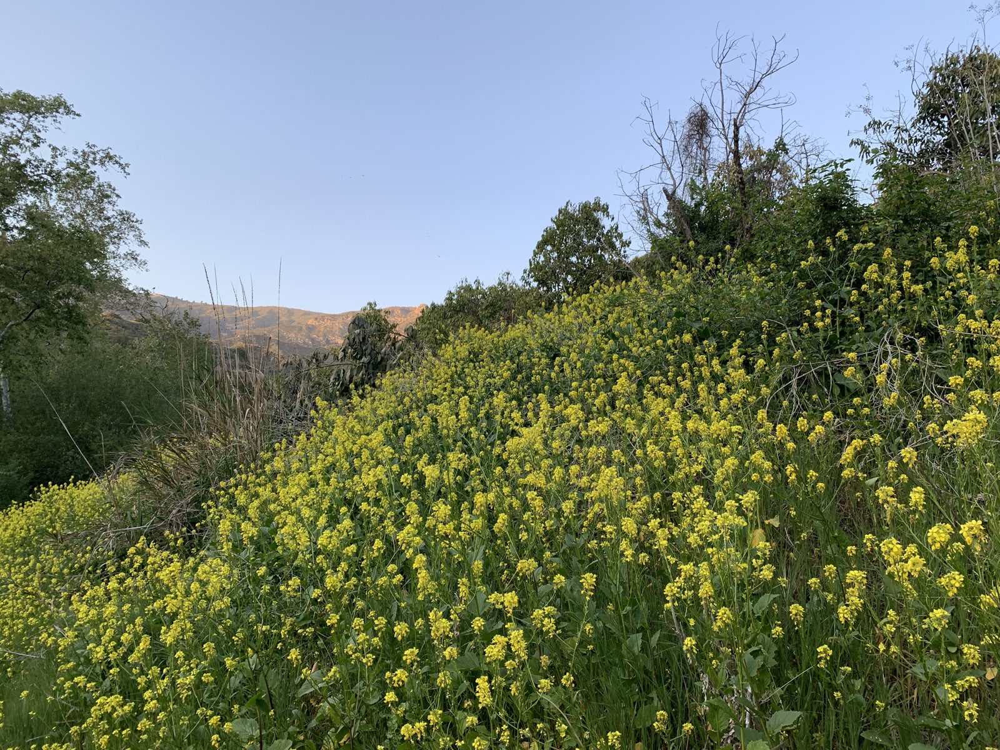

{fig-alt="Hillside covered in wildflowers"}

## Course description

Computer-based modeling and simulation are widely used tools in both practical environmental problem solving and in environmental research. Models give us a way to look at the world through a mixture of data and theory. A good model can help us to understand how the world works and how decisions that we make might change the world in ways that are important to us. There are many different types of models, from simple to complex, and models are often tailored to answer specific questions. This course will give you skills that help you to choose which model, or modeling technique, is right for you given the task at hand. The course will cover designing a new model and evaluating existing models. We will emphasize best practices, such as sensitivity and uncertainty analysis, that help to design and use models to reliably support environmental problem solving. This is a skills-based course and we will use R as our basic platform.

Class will include a mix of lectures and in-class hands-on examples, using students' own computers. Discussion sections will elaborate on lecture topics and provide time to work on assignments with instructor and TA support.

The full [syllabus (PDF)](syllabus.pdf) has grading, AI-tool policy and attendance details.

## Teaching team

**Instructor:** [Naomi Tague](https://tagueteamlab.org/)

-   **Office:** Bren Hall 4516
-   **Office hours:** email to set a time
-   **Email:** tague\@ucsb.edu

**Teaching assistant:** Ojas Sarup

-   **Office:** Bren Hall 1006
-   **Office hours:** TBA
-   **Email:** ojassarup@\ucsb.edu 

## Where we will be

-   **Lectures:** T, Thu 9:30-10:45, BH 1424
-   **Discussion section:** F 9-10:20 BH 1424

## Learning objectives

-   Gain familiarity with different types of models and the situations where you might use them
-   Understand how to choose the "right model" for the job
-   Know how to build simple models, including
    -   input-output models
    -   basic dynamic models
-   Gain some basic skills that are useful in applying models, including
    -   parameter sensitivity analysis
    -   uncertainty analysis
    -   model calibration and evaluation

## Computing

-   I will assume that everyone has some basic R skills, including how to use git, ggplot and Quarto, and how to build simple functions.
-   Many classes will be working classes, so bring your laptop to class.
-   Lecture slides are linked from the **Lectures** menu above. Example functions, data and Quarto files are in the course GitHub repository; pull before each class so you have the latest materials.

## Tentative schedule

| Week | Tuesday                                | Thursday                               | Discussion            |
|------|----------------------------------------|----------------------------------------|-----------------------|
| 1    | Intro: What is a model                 | Conceptual models                      | Conceptual models     |
| 2    | Building models                        | Informal sensitivity analysis          | Informal sensitivity  |
| 3    | Multiple parameter variation           | Multi-component models: RHESSys        | Building blocks       |
| 4    | Formal sensitivity analysis            | Sobol sensitivity analysis             | Free                  |
| 5    | Guest lecture                          | Dynamic models: analytical solutions   | Sobol sensitivity     |
| 6    | Dynamic models: ODE solver             | More on dynamic models                 | Output summary        |
| 7    | Sensitivity with dynamic models        | Disturbance and AI coding tools        | Free                  |
| 8    | Two variables and stability            | Guest lecture                          | Two-variable stability|
| 9    | What makes a good model                | Calibration                            | Calibration           |
| 10   | Calibration part 2                     | Return to the big picture              |                       |

## Assignments

There are 9 assignments plus weekly in-class quizzes. Some assignments will be done in groups. Most are short coding assignments with a one-paragraph write-up. Assignment instructions are linked from the **Assignments** menu above.

Assignments are submitted on [Canvas](https://www.canvas.ucsb.edu/), which also has grading rubrics you may find helpful. We also use Canvas for announcements.

## Protocols and guidance

-   Learning to program is hard and I may not always explain in a way that is accessible to you. If you don't understand something, *ask*.
    -   Ideally ask in class: you will help me learn how to explain (or find an answer if I don't know it), and you will help others.
    -   If you don't feel comfortable asking in class, reach out to me or the TA.
-   Environmental modeling and the coding involved get better with practice and play. Don't just read the Quarto documents: try the code, try variations on the ideas presented, make up stuff to try.
-   Programming means making mistakes. Expect it, stay calm and try again. If you get frustrated, step away and come back; be creative.
-   **Respect and support each other.**
    -   When working in groups, pay attention to your partner. If they are not at your skill level, help them learn; we all have different backgrounds.
    -   Listen. Different perspectives contribute to modeling. Ask questions and figure out how different people *see* the world (what is their conceptual model?).
    -   You learn by helping others, so do that!
-   If you are really struggling, reach out to the TA or me. We can help (or if you just want to chat about something).
