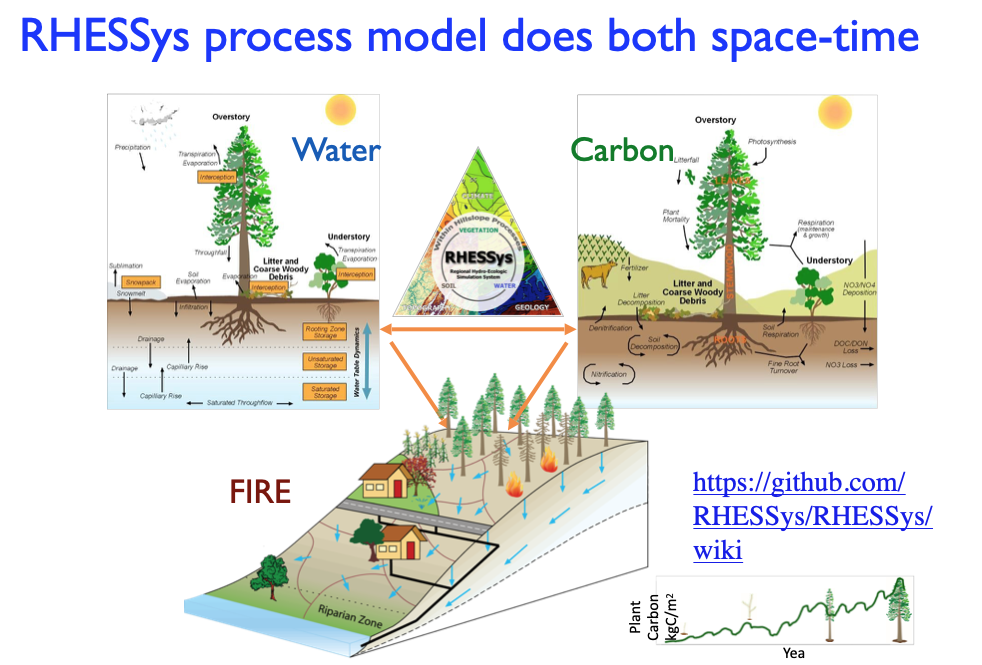
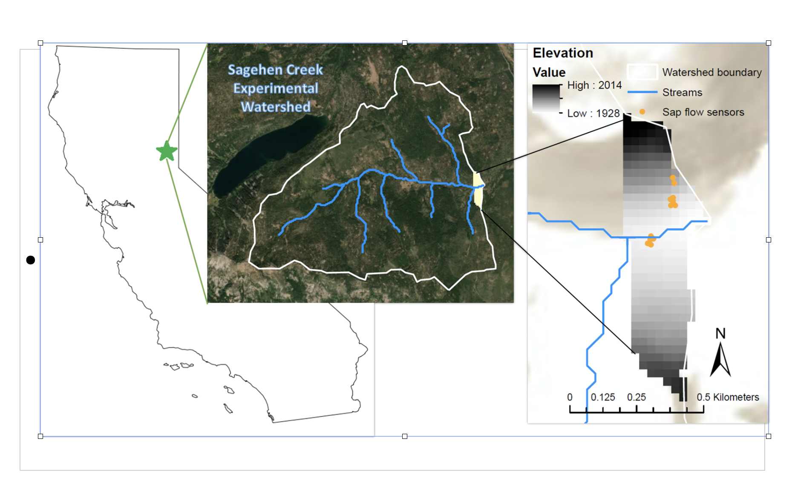

```{r setup, include=FALSE}
knitr::opts_chunk$set(echo = TRUE)
library(tidyverse)
library(here)
```

<!--
Designed for the second half of the Week 3 Thursday class ("Multi-component
models: RHESSys"), after the building-blocks material in Lecture6_buildingblocks.qmd.
About 40 minutes. Notes for Naomi are in ::: notes blocks (speaker view, press S).
-->

## From building blocks to a big model

-   So far: small boxes (solar → power → profit), connected with wrappers
-   Real environmental models are the same idea, with many more boxes
-   Today: a model built from many components, and **the conceptual choices behind it**
-   Key question for today: *how much of a big model do you actually need for your question?*

## Back to a question from Lecture 3

**Will a forest fire in the upper half of a watershed impact streamflow more than a similar fire lower in the watershed, nearer the stream?**

With a partner (5 min), and **without looking at any model**:

-   Draw the *smallest* conceptual model that could answer this question
-   What is the output (which flow? what time scale?)
-   What processes must be in the box? What can you safely leave out?

## Share

-   What did everyone include?
-   What did some groups include and others leave out?
-   Did anyone include *where* water goes after it leaves a hillslope? (lateral flow from upslope to downslope)

::: notes
Lecture 3's "initial ideas" slide had two components: why fire affects streamflow (tree ET) and why location matters (differences in water use, lateral downslope transport). Steer toward the second one: it's the part a lumped model can't capture.
:::

## Now the big model



## A model is a set of conceptual choices

RHESSys made choices about

-   **Space:** how the landscape is divided up (hillslopes, patches) and how water moves between those units
-   **Time:** which processes run at which time step
-   **Processes:** which ones are represented mechanistically and which are simplified
-   **What's left out**

::: notes
This is the place for your own design story. Suggestions:
- one structural decision that was made for a specific scientific question
- one decision that was a compromise (data, computing, or the state of the science)
- one decision you'd revisit now, and why
Students rarely hear the reasoning behind a real model's design. Even 2–3 concrete examples make the point that the conceptual model came first and the code followed.
:::

## Which boxes matter for *this* question?

Compare your small conceptual model with the RHESSys diagram

-   Which RHESSys components does the fire question actually need?
-   Which components are present but probably don't matter much for this question?
-   Is there anything in *your* model that RHESSys doesn't represent?

**Quiz:** name one RHESSys component you think you could ignore for the fire question, and why

## Why use a big model at all?

-   Your small model contains only what *you* thought mattered
-   A process-based model can show interactions you didn't expect (e.g. fire changes ET upslope, which changes water reaching downslope trees)
-   **But:** more components means more parameters, more data needs and more ways to be wrong
-   Model choice = matching the model's conceptual model to *your* question (Lecture 3: "is model structure appropriate?")

## More parameters → more uncertainty

RHESSys applied to Sagehen Creek (California Sierra)



## Same model, many parameter sets

```{r msage, echo=TRUE, eval=TRUE}
msage <- readRDS(here("Data/msage.RDS"))

# each column V1, V2, ... is one RHESSys run with a different parameter set
nruns <- ncol(msage) - 6
nruns

msagel <- msage %>%
  pivot_longer(
    cols = -c(date, month, day, year, wy, obs),
    names_to = "run",
    values_to = "str"
  )

ggplot(subset(msagel, wy == 1970), aes(as.Date(date), str, group = run)) +
  geom_line(alpha = 0.2) +
  labs(y = "Streamflow", x = "Date",
       title = "Water year 1970: every line is a different parameter set")
```

::: notes
Add streamflow units to the y-axis label. The full version of this analysis comes back in the calibration lectures (weeks 9–10), so this is just a preview.
:::

## Predict (we will come back to this)

The spread you just saw comes from uncertainty in a handful of parameters

-   **Quiz:** which *kinds* of parameters do you think cause most of the spread in summer low flow? In winter peak flow? Why might the answer differ?
-   Write it down. We will test this kind of prediction with formal sensitivity analysis next week, and come back to this ensemble in calibration.

::: notes
If you have the parameter values behind the msage runs, this slide could name the actual parameters that were varied. The same ensemble could then be used later for a sensitivity analysis on real RHESSys output (sample-based methods like sensitivity::pcc() or srrc() work with random samples; Sobol needs its own sampling design).
:::

## Takeaways

-   Big models are built from boxes, just like ours
-   Every model, big or small, starts from a conceptual model: someone decided what's in the box
-   Choosing a model = checking that *its* conceptual model fits *your* question
-   More components → more parameters → sensitivity analysis becomes essential to know which ones matter
